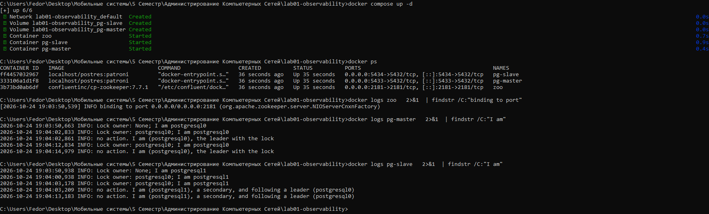
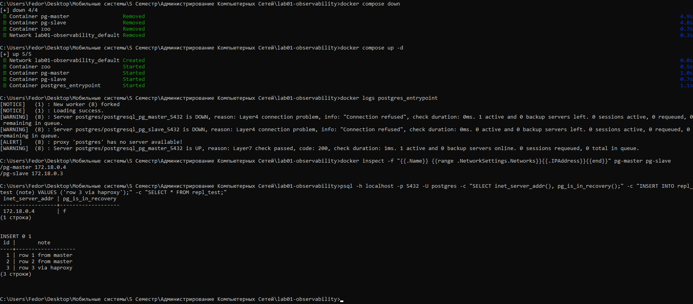
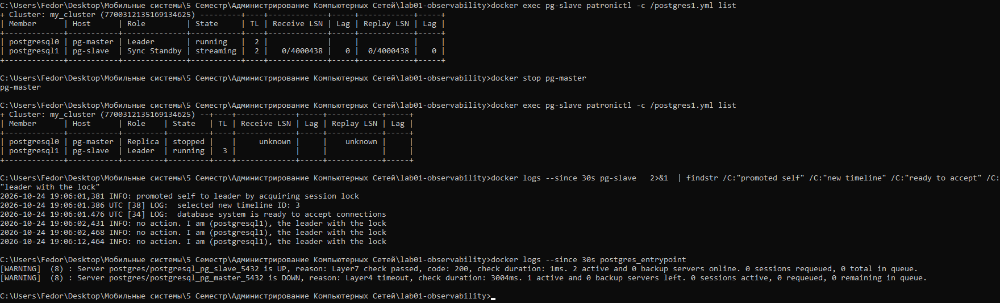
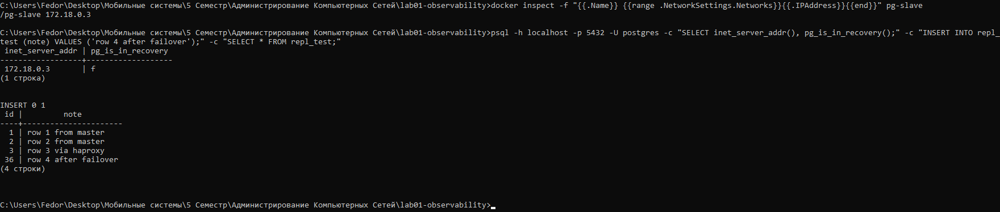
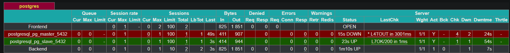
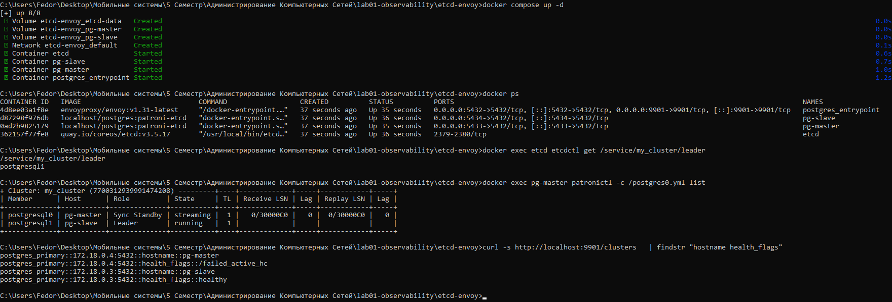
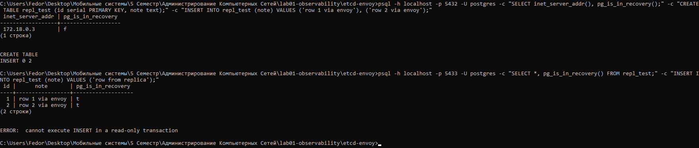
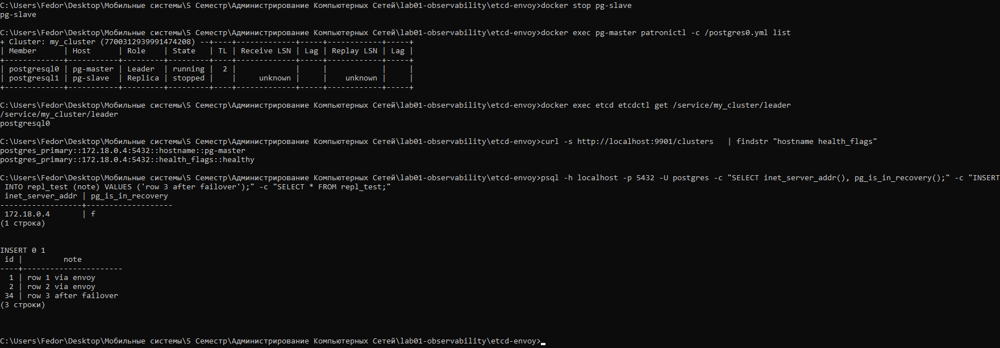

# ЛР 3. HA Postgres Cluster

Работу выполнил Смирнов Фёдор.

## Часть 1. Поднимаем Postgres

```
docker compose up -d --build
```

ZooKeeper слушает порт 2181. pg-master стал лидером, pg-slave стал репликой.



## Часть 2. Проверяем репликацию

Таблица создана на мастере (порт 5433), появилась на реплике (5434). Запись на реплике отклонена.


## Часть 3. Делаем высокую доступность

В compose добавлен сервис `haproxy` (`postgres_entrypoint`), рядом лежит `haproxy.cfg`. Проект перезапущен. ALERT в логе HAProxy появился только при старте, пока REST API Patroni ещё не отвечал. Затем pg-master прошёл проверку (200). Подключение через `localhost:5432` попало на pg-master (172.18.0.2), запись прошла.



## Задание.

После `docker stop pg-master` pg-slave взял ключ лидера в ZooKeeper и стал лидером (timeline 3). HAProxy пометил pg-slave как UP, pg-master как DOWN.



Через тот же `localhost:5432` попадаем на pg-slave (172.18.0.3). Старые строки на месте, запись проходит. Новая строка получила id 36, так как PostgreSQL записывает значения sequence в WAL с запасом на 32, и новый лидер продолжил с записанного.





Итог: переключение прошло автоматически, данные не потеряны, клиент работает через тот же адрес.

## Модификация 2: etcd и Envoy вместо ZooKeeper и HAProxy

Файлы в `etcd-envoy/`. Что изменено:
- `Dockerfile`: `patroni[zookeeper]` заменён на `patroni[etcd3]`;
- `postgresX.yml`: вместо секции `zookeeper` указано `etcd3: host: etcd:2379`;
- `docker-compose.yml`: `etcd` вместо `zoo` и `envoy` вместо `haproxy` (в `postgres_entrypoint` порты 5432 и 9901);
- `envoy.yaml`: TCP-прокси с порта 5432 на ноду, у которой `GET /primary` на порту 8008 отвечает 200. Параметры проверки те же, что в `haproxy.cfg`: `inter 3s`, `fall 3`, `rise 2`. Админка Envoy на порту 9901 заменяет страницу статистики HAProxy.

```
cd etcd-envoy
docker compose up -d --build
```

Лидером стала pg-slave: ключ `/service/my_cluster/leader` в etcd равен `postgresql1`.



Через Envoy (5432) запись идёт на лидера. На реплике pg-master (5433) данные есть, запись отклонена.



После `docker stop pg-slave` лидером стал pg-master: в etcd записан `postgresql0`, timeline 2. Envoy переключился на него. Запись через тот же `localhost:5432` проходит.



# Ответы на вопросы.

1. Порты 8008 и 5432/5433 вынесены в разные директивы, expose и ports. По сути, если записать 8008 в ports, то он тоже станет exposed. В чем разница?
Ответ: ports публикует порт на компьютере: Docker пробрасывает порт хоста в контейнер. Поэтому к pg-master можно подключиться с компьютера как localhost:5433, а к pg-slave как localhost:5434. expose наружу ничего не открывает и виден только внутри общей сети compose. Поэтому с компьютера порт 8008 недоступен. 5432 записан в ports, а 8008 в expose, потому что 8008 нужен только HAProxy и узлам кластера - он является REST API Patroni, и публиковать его на весь компьютер не нужно. Через него без пароля можно переключить лидера или перезапустить узел, поэтому для сохранения безопасности его лучше закрыть.
2. При обычном перезапуске композ-проекта, будет ли сбилден заново образ? А если предварительно отредактировать файлы postgresX.yml? А если содержимое самого Dockerfile? Почему?
Ответ: Нет во всех трёх случаях. Образ - это установочный файл/класс, который собирается единожды. При обычном перезапуске те же контейнеры перезапускаются с чистого листа. Если править postgres1.yml или Dockerfile, то изменения не затронут готовый образ. Для того чтобы пересобрать образ, нужно менять не файлы, а прежде всего вызвать docker compose up -d --build.